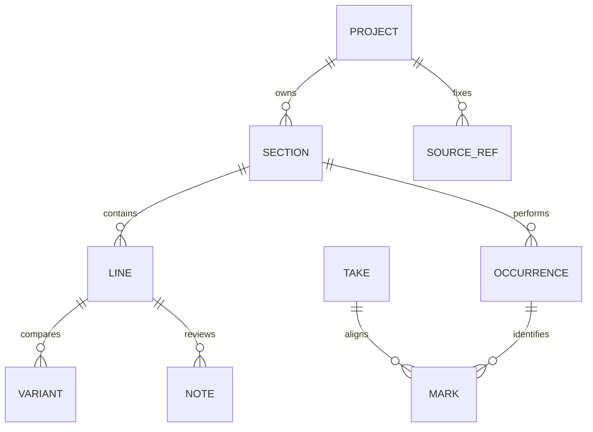

# 领域与本体设计

## 对象与不变量

| 对象 | 语义与归属 |
| --- | --- |
| Section | 主歌、副歌、桥段等结构值，不强制固定曲式 |
| Line | 段落内的歌词、明确读音、韵尾及长度约束，保留原文依据 |
| Occurrence | 歌曲编排中的一次段落出场；重复副歌使用不同ID并引用同一段 |
| Variant | 某句固定摘要上的备选与理由；使用后清空旧发音及音节标注，保留历史 |
| Take | 固定真实音频及其录制时歌词摘要，不等于选用或实际听审 |
| Mark | 固定录音中的一句出场，整数毫秒半开区间与原歌词摘要 |
| Note | 固定句或录音对齐摘要的原意见及来源；变更后显示过期 |
| Import | LRC原文、摘要与解释约定，保留无法往返的原始信息 |

段落与句子顺序在各自范围唯一；编排可重复同段但出场ID唯一。删除被编排、备选、标记和意见引用的内容须先显式处理引用，不能级联丢弃创作记录。每条Mark绑定Occurrence＋Line，允许多次副歌独立计时；同一录音不能重复标记同一句出场或重叠。

宿主WorkRef隔离小说、剧本、视频。来源只追加；同一实体ID不意味着跨作品共用。专业依据固定Owner、对象、修订和摘要，由Core回读核验。采用备选只更新专业歌词，不采纳宿主正文。
