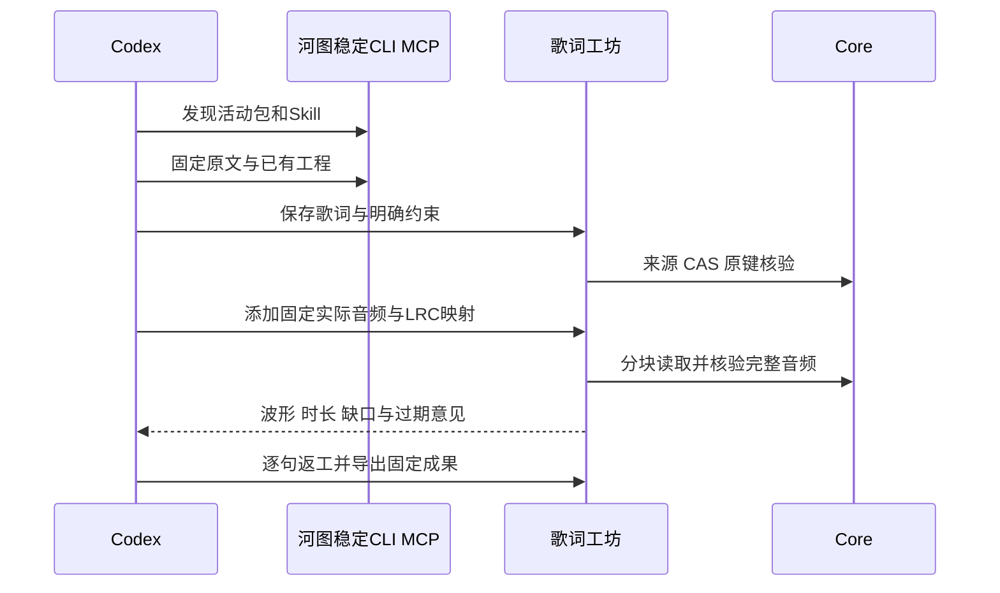

# 数据与API设计

## 格式与持久化

manifest_version=1、Host API=1、format_version=1和schema_version=1.0.0。可执行字段Owner是contracts/plugin-manifest.json，JSON Schema Draft-07及Ajv构建期编译，运行不使用eval。根字段为title、language_tag、brief、sections、lines、arrangement、variants、takes、marks、notes、imports和basis_refs。

Core现有专业对象及不可变修订持久化JSON，不新增SQL库和Migration。身份键是WorkRef＋owner_plugin_id＋object_id；revision＋sha256固定历史。单对象512KiB，最多100来源、40段、300句、80次出场、300备选、12录音、1000标记、200意见、20份LRC原件。单录音PCM16 WAV、8MiB、8k～48kHz、单／双声道；不静默转码或将音频嵌入专业JSON。

## 应用入口

先发现实际安装包和capabilities，再读skills.read。调用hetu.plugins.invoke携带确切management_ref、WorkRef、plugin_id、package_sha256和capabilities_sha256。新建使用revision=0及空摘要，更新带固定CAS基线和原操作键。get_operation先于未知重发，确切not_found才沿原键原输入恢复。同键异参和旧基线拒绝。

固定原文范围为UTF-8字节半开区间；来源内容转换后先公开回读再定位。音频通过sources.read_blob按分块和完整摘要核验，时长来自真实采样帧。变更歌词保留旧Take、Mark和Note摘要，显示stale；禁止用新版词解释旧版录音。

LRC保留原文，支持mm:ss及1～3位小数、多时间标签和明确元数据。正offset表示提前显示，effective_ms=tag_ms-offset_ms；负时间、重复时间和增强逐词标签拒绝，未识别内容如实返回诊断。导入须逐条匹配当前编排全文，最后一句终点取实际音频时长，时间不代表自动听取。导出三位小数；LRC不携带结束时间、稳定ID、意见和专业来源，完整JSON另行交付。

完整动作从CAPABILITIES导航，以当前安装Schema为准。专业报告分块验证SHA-256；HTML只作为文件，不在宿主执行。

