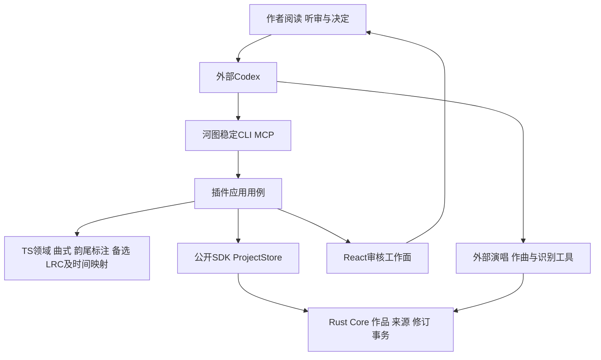

# 架构与技术选型

TypeScript领域处理结构、明确标注、实际WAV、时间与导出；React负责审核、播放和局部操作，Cordis生命周期由宿主提供，本包不内嵌调度框架。Rust只负责共享确定性事实和事务，专业包不要求Rust、FFI或原生动态库。

KISS保持一个专业聚合与一套CAS事务，DRY让来源、素材和版本归Core，SOLID使领域、应用、视图和分发分层。YAGNI不做乐谱引擎、自动作曲、在线音频搜索、音乐版权交易或完整DAW。与有声剧区别在歌词曲式与逐句试唱返工，有声剧拥有角色录音时间线和混音；字幕拥有多轨文字交付与画面播放，避免重复建通用字幕系统。
